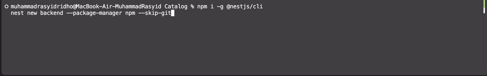
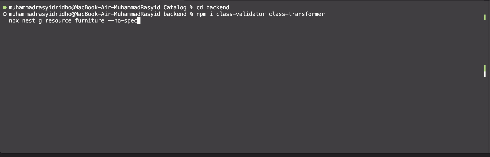
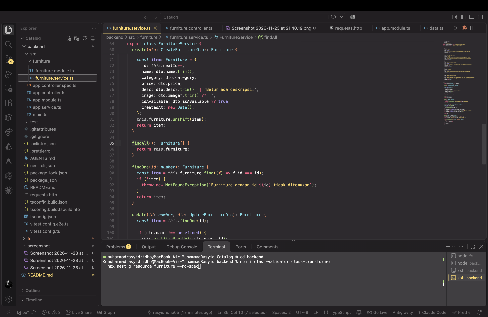
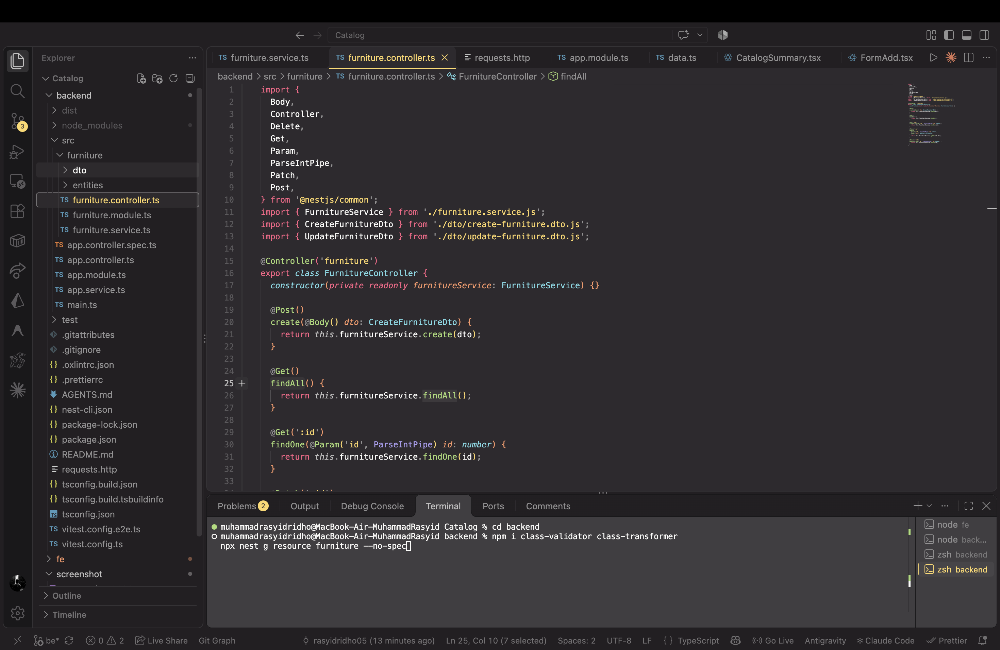
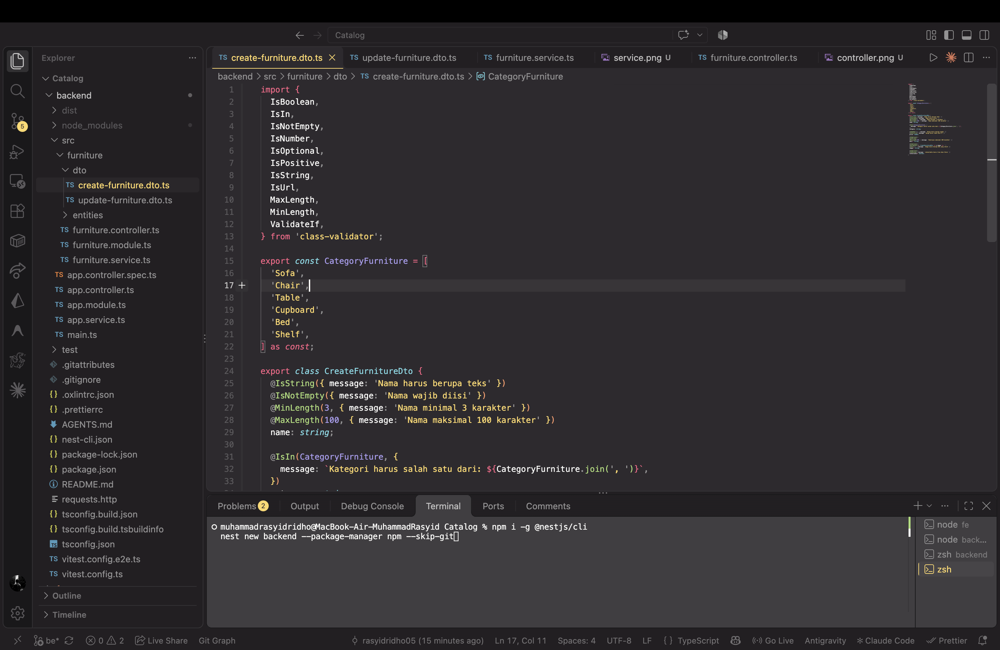
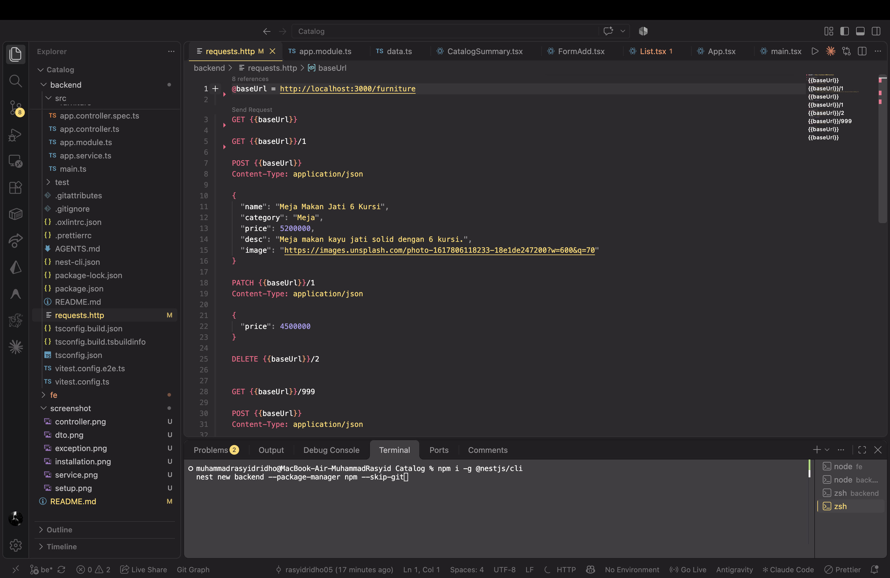
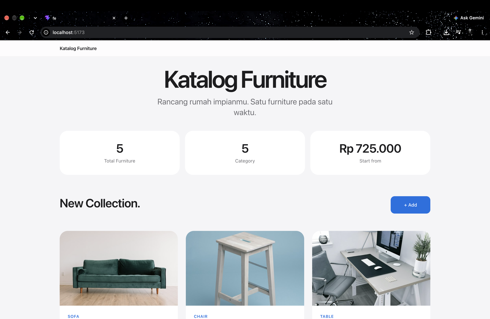
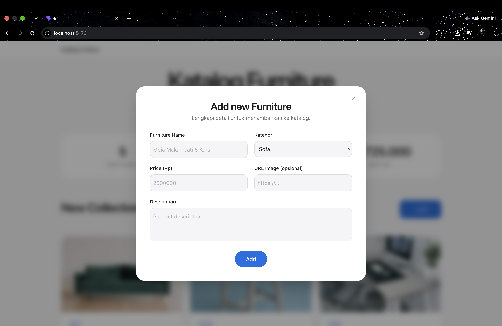
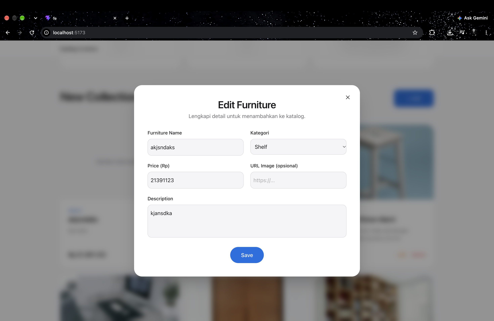
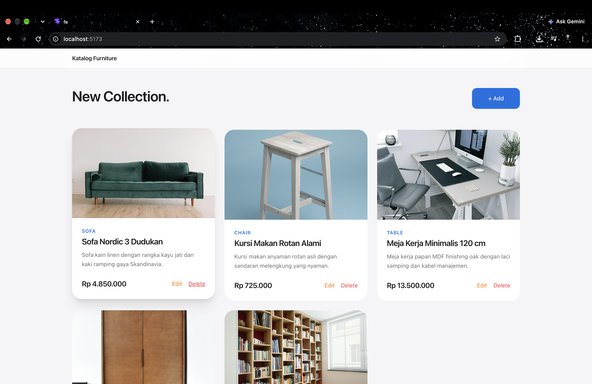

# Katalog Furniture

Aplikasi fullstack sederhana untuk mengelola katalog furniture. Pengguna dapat melihat daftar furniture, menambah, mengubah, dan menghapus data. Frontend dibangun dengan React + Vite + TypeScript + Tailwind CSS, dan backend dengan NestJS (struktur MVC) yang menyimpan data sementara di memori (array).

## Struktur Proyek

```
Catalog/
├── fe/        # Frontend (React + Vite + TypeScript + Tailwind CSS)
├── backend/   # Backend (NestJS)
└── screenshot/
```

## Data Utama: Furniture

| Field | Tipe | Keterangan |
|---|---|---|
| `id` | number | ID otomatis |
| `name` | string | Nama furniture (3–100 karakter, harus unik) |
| `category` | string | Salah satu dari: Sofa, Chair, Table, Cupboard, Bed, Shelf |
| `price` | number | Harga dalam Rupiah (> 0) |
| `desc` | string | Deskripsi (opsional, maks. 500 karakter) |
| `image` | string | URL gambar (opsional) |
| `isAvailable` | boolean | Status ketersediaan (default `true`) |
| `createdAt` | Date | Waktu data dibuat |

## Endpoint API

Base URL: `http://localhost:3000/furniture`

| Method | Endpoint | Fungsi |
|---|---|---|
| GET | `/furniture` | Ambil semua furniture |
| GET | `/furniture/:id` | Ambil satu furniture |
| POST | `/furniture` | Tambah furniture baru |
| PATCH | `/furniture/:id` | Ubah sebagian data furniture |
| DELETE | `/furniture/:id` | Hapus furniture |

### Validasi (class-validator + ValidationPipe global)

- `name`: `@IsString`, `@IsNotEmpty`, `@MinLength(3)`, `@MaxLength(100)`
- `category`: `@IsIn([...])`
- `price`: `@IsNumber`, `@IsPositive`
- `desc`, `image`, `isAvailable`: `@IsOptional` dengan aturan masing-masing (`@MaxLength`, `@IsUrl`, `@IsBoolean`)
- `UpdateFurnitureDto` memakai `PartialType` sehingga semua field menjadi opsional

### Penanganan Error

| Status | Exception | Kondisi |
|---|---|---|
| 404 | `NotFoundException` | Furniture dengan id tersebut tidak ditemukan |
| 409 | `ConflictException` | Nama furniture sudah dipakai |
| 400 | `BadRequestException` (ValidationPipe / ParseIntPipe) | Data tidak valid atau id bukan angka |

## Cara Menjalankan

### Backend
```bash
cd backend
npm install
npm run start:dev   # http://localhost:3000
```

### Frontend
```bash
cd fe
npm install
npm run dev         # http://localhost:5173
```

Jalankan keduanya bersamaan.

## Tahapan Pengerjaan

### 1. Setup project NestJS
Project dibuat dengan Nest CLI, lalu dependensi validasi dipasang (`class-validator`, `class-transformer`).



### 2. Generate resource `furniture`
Resource dibuat dengan `npx nest g resource furniture`, lalu Entity disesuaikan (8 field dengan tipe bervariasi).



### 3. Implementasi Service (CRUD di memori)
`create`, `findAll`, `findOne`, `update`, `remove` dengan penyimpanan array di memori.



### 4. Implementasi Controller
Seluruh endpoint (GET, POST, PATCH, DELETE) memanggil Service melalui dependency injection.



### 5. DTO dan Validasi
`CreateFurnitureDto` dan `UpdateFurnitureDto` dengan class-validator; `ValidationPipe` diaktifkan global di `main.ts`.



### 6. Penanganan error
`NotFoundException` dan `ConflictException` di Service.


### 7. Pengujian endpoint dengan REST Client
File pengujian: [`backend/requests.http`](backend/requests.http)




### 8. Integrasi frontend dan backend
Frontend mengambil data dari API dan mendukung alur penuh: tambah, ubah, dan hapus data.

**Tampilan awal (data dari backend)**


**Tambah data (form pop-up)**


**Ubah data**


**Hapus data**



## Teknologi

- **Frontend:** React, Vite, TypeScript, Tailwind CSS
- **Backend:** NestJS, class-validator, class-transformer
- **Pengujian API:** REST Client (VS Code)